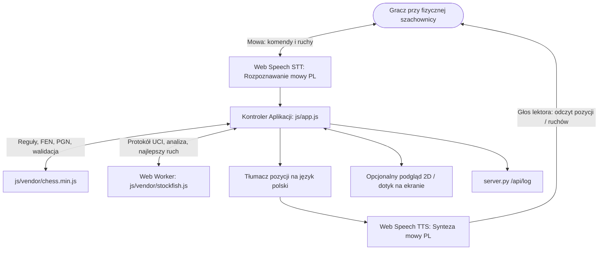

# Plan Wymagań i Prac: MowoSzachy (Mowo-Szachy)

## 1. Wizja i Cel Projektu
**MowoSzachy** to lekka, responsywna aplikacja internetowa (PWA) działająca na smartfonach (Chrome / Safari), służąca do treningu gry w **fizyczne szachy** (na tradycyjnej, fizycznej szachownicy). 
Gracz kładzie telefon obok szachownicy, a aplikacja pełni rolę mówionego asystenta, trenera oraz sparingpartnera.

### Kluczowe założenia:
- **Zero wzroku na ekranie (opcjonalnie)**: Gracz skupia się na fizycznych figurach i drewnianej desce.
- **Komunikacja głosowa po polsku**: Lektor czyta pozycje, ruchy rywala i zadania taktyczne w naturalnym języku polskim. Mikrofon nasłuchuje polskich komend szachowych.
- **Wbudowany silnik szachowy**: Stockfish.js pracujący lokalnie w Web Workerze w przeglądarce telefonu (brak opóźnień sieciowych, praca offline).
- **Zadania taktyczne offline**: Zestaw zadań taktycznych (maty, motywy) z dyktowaniem pozycji początkowej.
- **Zero build step & Statyczny hosting**: Czysty HTML5, CSS3 i ES Modules. Gotowe do natychmiastowego wdrożenia na GitHub Pages z pełnym HTTPS.

---

## 2. Architektura Systemu

---

## 3. Główne Moduły Funkcjonalne

### 3.1. Tryb Gry: Partia z Silnikiem (Stockfish)
1. **Wybór koloru i poziomu**: Gracz wybiera grę białymi lub czarnymi oraz siłę silnika (głębokość analizy 2–18).
2. **Dyktowanie ruchu przez gracza**:
   - Rozpoznawanie mowy: "skoczek f3", "e4", "pionek na e4", "goniec bije na d5", "krótka roszada".
   - Sprawdzenie legalności w `chess.js`. Jeśli nielegalny – asystent mówi: *"To nie jest poprawny ruch w tej pozycji"*.
3. **Odpowiedź silnika**:
   - Stockfish oblicza ruch, wykonuje go w stanie gry.
   - Lektor natychmiast mówi po polsku: *"Silnik gra: Wieża na d8, szach"*.
   - Gracz przestawia figurę silnika na swojej fizycznej desce.

### 3.2. Tryb Treningowy: Zadania Taktyczne (Puzzles)
1. **Wbudowana baza łamigłówek offline**:
   - Zestaw 100–200 zadań podzielonych na kategorie (Mat w 1, Mat w 2, Widełki skoczkiem, Związania, Usunięcie obrońcy).
   - Możliwość wklejenia własnego FEN/PGN.
2. **Dyktowanie rozstawienia figur**:
   - Asystent czyta sekwencyjnie pozycję:
     *"Ustawienie zadania. Białe: Król na g1, Hetman na d1, Wieże na a1 i f1... Czarne: Król na g8... Białe zaczynają i dają mata w dwóch ruchach."*
   - Przyciski szybkiego powtórzenia: *"Powtórz białe"*, *"Powtórz czarne"*, *"Jaki jest cel zadania"*.
3. **Weryfikacja rozwiązania**:
   - Gracz dyktuje ruch. Aplikacja sprawdza czy to ruch wygrywający.
   - Komunikaty motywacyjne: *"Świetnie! Mat w kolejnym ruchu"*, *"Błąd, spróbuj jeszcze raz"*.

### 3.3. Moduł Opisu Pozycji (Position Describer PL)
- Formatowanie stanu szachownicy do naturalnego języka polskiego:
  - Grupowanie według figur: Król, Hetman, Wieże, Gońce, Skoczki, Piony.
  - Prawidłowa odmiana i współrzędne: np. *"Skoczki na c3 i f3"*, *"Pionki na a2, b2, c3, f2, g2, h2"*.
  - Informacja o kolejce ruchu, roszadach i szachu.

### 3.4. Interfejs Mobilny (Chrome Mobile / PWA)
- Duże przyciski dotykowe (min. 48px) ułatwiające kliknięcie ręką znad szachownicy.
- Dynamiczna karta mowy z dużą czcionką (czytelną z odległości 1 metra na stole).
- Rozwijany podgląd 2D szachownicy kontrolnej (weryfikacja czy fizyczna deska zgadza się ze stanem w telefonie).
- PWA `manifest.json` – możliwość dodania ikony do ekranu głównego telefonu.

---

## 4. Harmonogram Prac (Etapy Realizacji)

- [x] **Etap 0: Szkielet i Infrastruktura**
  - Struktura katalogów, serwer deweloperski Python, skrypty start/stop/logi.
  - Skopiowanie i konfiguracja skilli BMAD (`.agents/skills`, `_bmad/`).
  - Pobranie i integracja bibliotek offline (`chess.min.js`, `stockfish.js`).
  - Podstawowy interfejs mobilny, moduł TTS i STT po polsku, obsługa ruchów.
  - Inicjalizacja repozytorium Git i pierwszy commit.

- [x] **Etap 1: Tryb Gry z Silnikiem (Stockfish) i Automatyczna Rozgrywka**
  - Domyślny tryb gry z silnikiem: automatyczna odpowiedź Stockfisha po ruchu gracza (brak konieczności klikania po każdym ruchu).
  - Wybór strony (Białe / Czarne): silnik automatycznie rozpoczyna partię pierwszym ruchem, gdy gracz wybierze Czarne.
  - Fonetyczny parser polskich komend szachowych i ruchów (obsługa liter: *a-h*, liczb *1-8*, figur *skoczek/koń, goniec/laufer, wieża, hetman/dama, król, pion*, roszad i bicia).
  - Inteligentne cofanie ruchów w trybie silnika (cofnięcie ruchu silnika i poprzedzającego ruchu gracza).
  - Sygnał dźwiękowy (gong Web Audio) po wykonaniu ruchu przez silnik.
  - Podświetlanie pól ostatniego ruchu (`from`, `to`) na szachownicy kontrolnej oraz automatyczne odwracanie deski dla czarnych.
  - Zapisywanie i odczyt preferencji w `localStorage`.

- [x] **Etap 3: Ustawienia, Personalizacja i Dźwięk**
  - Wybór głosu lektora, prędkości czytania (0.7x – 1.4x).
  - Konfiguracja siły silnika (głębokość analizy 2–18).
  - Opcjonalny auto-nasłuch mikrofonu po wypowiedzeniu ruchu przez silnik.

- [ ] **Etap 2: Baza Zadań Taktycznych i Dyktowanie Pozycji (Kolejny krok)**
  - Przygotowanie bazy JSON z zadaniami taktycznymi (zgodnie z życzeniem użytkownika: realizowane po pełnej grze z silnikiem).
  - Dedykowany ekran/widok "Trening Taktyki": wybór poziomu, przyciski nawigacji zadań.
  - Funkcja "Dyktuj krok po kroku" (pauzy między figurami, powtórz partię figur).

- [ ] **Etap 4: Publikacja na GitHub i Wdrożenie GitHub Pages**
  - Konfiguracja GitHub Actions / branch `main` dla GitHub Pages.
  - Test na smartfonie przez HTTPS (wymagane dla uprawnień mikrofonu).
  - Weryfikacja PWA (instalacja na pulpicie telefonu).
